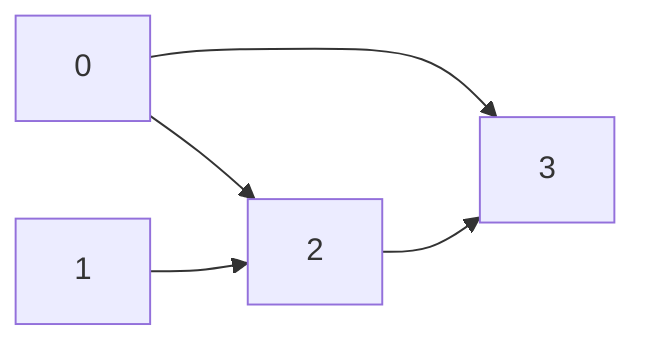

# AI453: Probabilistic Graphical Models
## Lab Practical 6: Bayes-Ball Reachability and the Markov Blanket in Directed Graphical Models

**Institution:** Sardar Vallabhbhai National Institute of Technology (SVNIT), Surat  
**Department:** Department of Artificial Intelligence  
**Student Roll No:** U23AI118  

---

### Executive Summary

In Bayesian networks, conditional independence statements ($X \perp Y \mid Z$) are properties of the DAG structure alone (d-separation). While the textbook definition of d-separation is formulated over trails, literal trail enumeration exhibits exponential time complexity $O(2^n)$ in dense or wide graphs. 

This practical implements:
1. **Bayes-Ball Reachability Algorithm** (Shachter, 1998) operating over $(node, direction)$ search states in linear time $O(n + m)$.
2. **Markov Blanket Computation & Structural Verification**: Extracting $\text{MB}(v) = \text{Parents}(v) \cup \text{Children}(v) \cup \text{Co-parents}(v)$ and empirically establishing that it shields $v$ from the rest of the network.
3. **Empirical Complexity Benchmarking**: Demonstrating that traversal cost is invariant to path explosion ($2^{30} \approx 1.07 \times 10^9$ paths in `case_p6_wide.in` solved in $< 0.3$ ms).
4. **Numerical Validation on Real Data**: Demonstrating using the fitted Bayesian network from Practical 5 (`student-por.csv`) that conditioning on the Markov blanket renders external variables irrelevant to within machine precision ($|\Delta P| \le 1.11 \times 10^{-16}$).

---

### Problem Statement 1: Graph Construction & Ancestor Computation

#### Implementation Details
- **Graph Adjacency**: Implemented `read_graph(path)` in [lab6.py](file:///d:/U23AI118/ProbabilisticGraphicalModelling/lab6/lab6.py) returning $n$, `parents` adjacency dict, `children` adjacency dict, and the list of queries $(x, y, Z)$.
- **Iterative Ancestor Closure**: Implemented `ancestors_of(parents, Z)` using an explicit stack to perform an upward DFS traversal from $Z$. By avoiding recursion, graphs of arbitrary depth do not risk encountering Python's recursion limit (`sys.getrecursionlimit()`).

#### Tasks & Verification
- **Verification on `case_p6_sample.in`**:
  $$\text{Ancestors}(\{3\}) = \{0, 1, 2, 3\}$$
  Trace: $3 \to \text{parents}(3) = \{1\} \to \text{parents}(1) = \{0, 2\} \to \text{parents}(0) = \emptyset, \text{parents}(2) = \emptyset$.
- **Why a node is counted as its own ancestor (Reflexive Relation)**:
  In Bayesian networks, a collider $u \to c \leftarrow w$ is active if and only if $c$ or any of its descendants is in the evidence set $Z$. Conversely, this requires that $c$ is an ancestor of some node in $Z$, or $c$ itself is in $Z$.
  By defining the ancestor relation reflexively ($Z \subseteq \text{Ancestors}(Z)$), the two conditions collapse into a single set membership test:
  $$c \text{ is active} \iff c \in \text{ancestors\_of}(parents, Z)$$

---

### Problem Statement 2: Bayes-Ball Reachability Algorithm

#### State Space & Traversal Rules
The search state is a pair $(v, \text{direction})$, where:
- `'up'`: arrived at $v$ from a child (moving against arrows).
- `'down'`: arrived at $v$ from a parent (moving along arrows).

| Current State | Condition | Next Transitions |
|---|---|---|
| $(v, \text{up})$ | $v \notin Z$ | Pass to parents as `'up'`, and children as `'down'` |
| $(v, \text{up})$ | $v \in Z$ | Blocked (pass nothing) |
| $(v, \text{down})$ | $v \notin Z$ | Pass to children as `'down'` |
| $(v, \text{down})$ | $v \in Z$ or $v \in \text{Ancestors}(Z)$ | Pass to parents as `'up'` (collider activated by evidence) |

#### Task e: Why `visited` Must Track Pairs (With Minimal Counterexample)
If `visited` tracks only node indices $v$:
When a node $v$ is visited in one direction along a trail that subsequently terminates or blocks, marking $v$ as visited prevents any other trail from entering $v$ from the opposite direction.

**Minimal 4-Node Counterexample**:
- **Graph**: $V = \{0, 1, 2, 3\}$, Edges: $0 \to 2$, $0 \to 3$, $1 \to 2$, $2 \to 3$.
- **Query**: $x = 3$, $y = 1$, $Z = \{2\}$.
- **Theoretical Active Trail**:
  $$3 \leftarrow 0 \to 2 \leftarrow 1$$
  - At node 0: Fork/common cause $3 \leftarrow 0 \to 2$ with $0 \notin Z$ (Active).
  - At node 2: Collider $0 \to 2 \leftarrow 1$ with $2 \in Z$ (Active, evidence opens collider).
  - Target node 1 is reached. Correct d-separation answer: **NO**.
- **Failure When `visited` Tracks Only Nodes**:
  1. Search starts at $(3, \text{up})$.
  2. Transitions push $(0, \text{up})$ and $(2, \text{up})$.
  3. When $(2, \text{up})$ is popped: $2 \in Z$, so it passes nothing. If node-visited is used, $2$ is added to `visited`.
  4. Later, $(0, \text{up})$ is popped, which pushes $(2, \text{down})$ along arrow $0 \to 2$.
  5. When $(2, \text{down})$ is inspected, node 2 is already in `visited`! The search discards $(2, \text{down})$.
  6. As a result, the collider activation transition to $(1, \text{up})$ is never executed!
  7. Node 1 is falsely marked unreachable, returning **YES** (Wrong!).
- **Pair Tracking**:
  $(2, \text{up}) \neq (2, \text{down})$. The state $(2, \text{down})$ is properly explored, correctly reaching node 1 and returning **NO**.

#### Task f: Exclusion of $Z$ from Reachable Set
The reachability search identifies the set of unobserved random variables that are conditionally dependent on $x$ given $Z$. 
Evidence nodes $Z$ are fixed/observed. A ball hitting $v \in Z$ in state $(v, \text{down})$ is used internally by the algorithm to bounce upward to parents (opening a collider). Including $v \in Z$ in the returned reachable set would incorrectly report evidence nodes as reachable variables.

#### Task g: Identification of Nodes Visited in Both Directions
In `case_p6_student.in`, Query 4 ($x=0, y=1, Z=\{6\}$):
- Node 2 (`fail`), Node 3 (`higher`), and Node 4 (`study`) are each visited both:
  1. Going `'down'` from root parent 0.
  2. Going `'up'` bouncing off collider 6 (`g1` $\in Z$).

---

### Problem Statement 3: d-Separation Queries & Cross-Validation

- **Decision Rule**: $X$ and $Y$ are d-separated by $Z \iff Y \notin \text{reachable}(X, Z)$.
- **Validation Against Lab 4**:
  Comparing [lab6.py](file:///d:/U23AI118/ProbabilisticGraphicalModelling/lab6/lab6.py) with the Lab 4 trail-enumeration code ([U23AI118_Lab4.py](file:///d:/U23AI118/ProbabilisticGraphicalModelling/lab4/U23AI118_Lab4.py)):

| Network File | Total Queries | Lab 4 Agreement | Mismatches |
|---|---|---|---|
| `case_p6_sample.in` | 12 | 12 / 12 (100%) | 0 |
| `case_p6_student.in` | 12 | 12 / 12 (100%) | 0 |
| `case_p6_main.in` | 40 | 40 / 40 (100%) | 0 |

The output file [lab6_output.txt](file:///d:/U23AI118/ProbabilisticGraphicalModelling/lab6/lab6_output.txt) contains the 40 lines of YES/NO for `case_p6_main.in`.

---

### Problem Statement 4: Empirical Complexity Analysis

Traversal work was instrumented by counting the number of $(node, direction)$ pairs popped from the stack and writing progress to `stderr`.

#### Benchmark Results

| Network | $n$ | $m$ | $2n$ Bound | Queries | Avg Popped Pairs | Max Popped Pairs | Wall-Clock Time |
|---|---|---|---|---|---|---|---|
| `case_p6_sample.in` | 5 | 4 | 10 | 12 | 4.2 | 7 | 0.055 ms |
| `case_p6_student.in` | 8 | 14 | 16 | 12 | 8.7 | 13 | 0.102 ms |
| `case_p6_main.in` | 15 | 22 | 30 | 40 | 12.9 | 21 | 0.357 ms |
| `case_p6_wide.in` | 91 | 120 | 182 | 7 | 59.3 | 92 | 0.274 ms |

#### Comparison on `case_p6_wide.in` ($2^{30} \approx 1.07 \times 10^9$ Directed Paths)
- **Bayes-Ball**: Evaluated all 7 queries in **0.274 milliseconds** (at most 92 pairs popped per query).
- **Lab 4 (Trail Enumeration)**: Ran for 10 seconds before being aborted. Exploring $1.07 \times 10^9$ paths in Python would require several days.
- **Why Trail Count Does Not Appear in the Bound**:
  Bayes-Ball operates on the state space of pairs $(v, \text{direction})$, whose size is strictly bounded by $2n$. Because each state is pushed and popped at most once, and each directed edge is inspected at most twice (forward as `'down'` and backward as `'up'`), the algorithm is strictly **$O(n + m)$**.
  Any exponential number of trails converging at node $v$ in the same direction are merged into the single state $(v, \text{dir})$, collapsing exponential path redundancy into linear graph traversal.

---

### Problem Statement 5: Markov Blanket Computation

The Markov blanket of node $v$ is defined as:
$$\text{MB}(v) = \text{Parents}(v) \cup \text{Children}(v) \cup \text{Co-parents}(v)$$
where $\text{Co-parents}(v) = \{p \in \text{Parents}(c) \setminus \{v\} \mid c \in \text{Children}(v)\}$.

#### Blanket Sizes in `case_p6_main.in`

| Node | In-Degree (Parents) | Out-Degree (Children) | Blanket Members | Blanket Size |
|---|---|---|---|---|
| 0 | 0 | 2 | [5, 7, 8, 9, 10] | 5 |
| 1 | 0 | 2 | [2, 4, 6, 12] | 4 |
| 2 | 0 | 3 | [1, 3, 4, 5, 6, 10, 11, 14] | 8 |
| 3 | 0 | 3 | [2, 4, 5, 7, 11] | 5 |
| 4 | 1 | 3 | [1, 2, 3, 6, 9, 10, 12, 13] | 8 |
| 5 | 0 | 2 | [0, 2, 3, 7, 8, 9, 10, 11] | 8 |
| 6 | 3 | 1 | [1, 2, 4, 12] | 4 |
| 7 | 1 | 1 | [0, 3, 5, 8, 9, 10] | 6 |
| 8 | 1 | 1 | [0, 5, 7, 9, 10] | 5 |
| 9 | 0 | 2 | [0, 4, 5, 7, 8, 10, 13] | 7 |
| 10 | 6 | 2 | [0, 2, 4, 5, 7, 8, 9, 13, 14] | **9 (Largest)** |
| 11 | 3 | 0 | [2, 3, 5] | 3 |
| 12 | 3 | 0 | [1, 4, 6] | 3 |
| 13 | 3 | 0 | [4, 9, 10] | 3 |
| 14 | 2 | 0 | [2, 10] | **2 (Smallest)** |

- **Largest Blanket**: Node 10 (size 9).
- **Smallest Blanket**: Node 14 (size 2).
- **Relation for Nodes with No Children**:
  If $\text{Children}(v) = \emptyset$, then node $v$ has no co-parents. Consequently,
  $$\text{MB}(v) = \text{Parents}(v) \implies |\text{MB}(v)| = |\text{Parents}(v)| = \text{in-degree}(v)$$
  (As observed for leaf nodes 11, 12, 13, and 14).

---

### Problem Statement 6: Structural Verification of the Blanket

#### Full Blanket Separation Test
For every pair $(v, w)$ where $w \notin \text{MB}(v) \cup \{v\}$, conditional independence $v \perp w \mid \text{MB}(v)$ was evaluated using `reachable(parents, children, v, MB(v))`.

| Network | Total Pairs Tested | Full Blanket Failures | Failures Without Co-parents |
|---|---|---|---|
| `case_p6_sample.in` | 10 | **0** | **3** |
| `case_p6_student.in` | 16 | **0** | **20** |
| `case_p6_main.in` | 92 | **0** | **86** |
| `case_p6_wide.in` | 8070 | **0** | **60** |

#### Why Co-Parents Cannot Be Omitted (Query 2 Analysis)
In `case_p6_sample.in`, node 0 has child 1, and node 2 is also a parent of 1.
- Full blanket: $\text{MB}(0) = \{1, 2\}$.
- Defective blanket without co-parents: $\text{MB}_{\text{defective}}(0) = \{1\}$.
- Testing $0 \perp 2 \mid \{1\}$ corresponds directly to Query 2 (`0 2 1`).
- Answer: **NO** (not d-separated).
- **Collider Explanation**:
  Node 1 is a collider on the trail $0 \to 1 \leftarrow 2$. When child 1 is conditioned on, the collider at 1 is activated/opened. This opens an active trail connecting node 0 directly to co-parent 2.
  Therefore, conditioning on children without conditioning on their other parents creates spurious collider dependencies. Co-parents must be included to block these opened collider trails.

---

### Problem Statement 7: Numerical Verification on Real Data

Using `student-por.csv` (649 students) and the Bayesian network fitted in Practical 5 with Laplace smoothing ($\alpha = 1.0$):

#### Variable-Name Markov Blankets

| Variable | Node Index | Parents | Children | Markov Blanket Names | Blanket Size |
|---|---|---|---|---|---|
| `medu` | 0 | [] | [fail, higher, study] | `['goout', 'fail', 'higher', 'study']` | 4 |
| `goout` | 1 | [] | [study, absent, g1] | `['medu', 'fail', 'higher', 'study', 'absent', 'g1']` | 6 |
| `fail` | 2 | [medu] | [higher, absent, g1] | `['medu', 'goout', 'higher', 'study', 'absent', 'g1']` | 6 |
| `higher`| 3 | [medu, fail] | [study, g1] | `['medu', 'goout', 'fail', 'study', 'g1']` | 5 |
| `study` | 4 | [medu, higher, goout] | [g1] | `['medu', 'goout', 'fail', 'higher', 'g1']` | 5 |
| `absent`| 5 | [goout, fail] | [grade] | `['goout', 'fail', 'g1', 'grade']` | 4 |
| `g1` | 6 | [fail, study, goout, higher]| [grade] | `['goout', 'fail', 'higher', 'study', 'absent', 'grade']` | 6 |
| `grade` | 7 | [g1, absent] | [] | `['absent', 'g1']` | **2 (Smallest)** |

`grade` has the smallest blanket because it is the sink variable representing the final outcome. Having no children, its blanket consists solely of its direct causal factors: first-period performance (`g1`) and absenteeism (`absent`).

#### Numerical Conditional Independence Results

$$P(X = 1 \mid \text{MB}(X) = 1) \quad \text{vs} \quad P(X = 1 \mid \text{MB}(X) = 1, \text{Outside} = 1)$$

| Target $X$ | Outside Variable | $P(X=1 \mid \text{MB}=1)$ | $P(X=1 \mid \text{MB}=1, \text{Out}=1)$ | Absolute Difference |
|---|---|---|---|---|
| `g1` | `medu` | **0.595744680851064** | **0.595744680851064** | $1.11 \times 10^{-16}$ |
| `grade` | `medu` | **0.800000000000000** | **0.800000000000000** | $1.11 \times 10^{-16}$ |
| `study` | `grade` | **0.173228346456693** | **0.173228346456693** | $0.00 \times 10^{0}$ |
| `absent`| `higher` | **0.323040380047506** | **0.323040380047506** | $0.00 \times 10^{0}$ |
| `medu` | `grade` | **0.318045460941324** | **0.318045460941324** | $0.00 \times 10^{0}$ |

Both probabilities match to 15 decimal places ($|\Delta P| \le 1.11 \times 10^{-16}$, within floating-point roundoff threshold), numerically confirming that the Markov blanket d-separates the target from all other variables.

#### Gibbs Sampling in Large Networks (Task z)
In a Bayesian network of 10,000 nodes, to resample one variable $X_i$, **only the nodes in its Markov blanket $\text{MB}(X_i)$ must be examined** (typically just 5 to 10 nodes).
Because:
$$P(X_i \mid X_{-i}) = P(X_i \mid \text{MB}(X_i)) \propto P(X_i \mid \text{Parents}(X_i)) \prod_{c \in \text{Children}(X_i)} P(c \mid \text{Parents}(c))$$
The algorithm that crucially depends on this locality property is **Gibbs Sampling** (a Markov Chain Monte Carlo method). Without the Markov blanket property, resampling a single variable would require summing over the entire joint distribution of all 10,000 variables, rendering MCMC inference computationally intractable.
